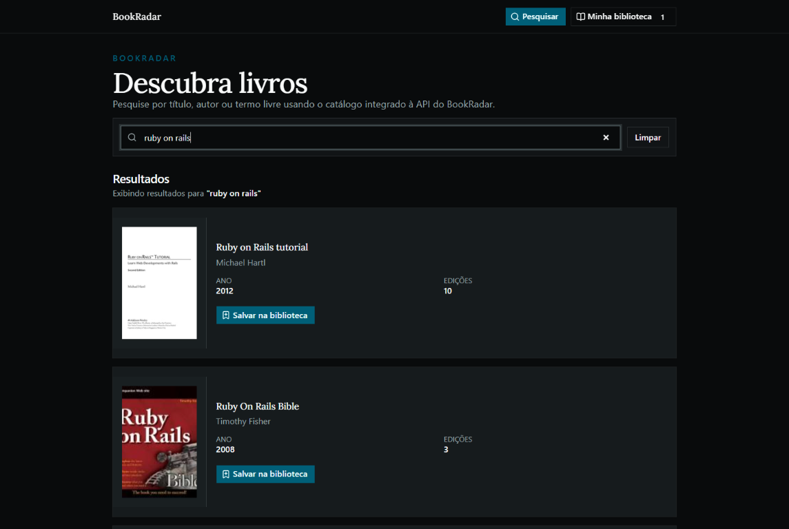

# BookRadar

BookRadar é uma aplicação educacional para pesquisar livros e organizar uma biblioteca pessoal de leitura. O projeto foi desenvolvido como exercício prático de aprendizado de Ruby on Rails, combinando uma API Rails com uma interface React para explorar conceitos de backend, integração com uma API externa e estado no cliente.

> Este repositório representa um projeto de estudo. Ele não é apresentado como um produto comercial nem como uma aplicação pronta para produção.

## Capturas de tela

| Pesquisa | Resultados da Open Library |
| --- | --- |
|  |  |

| Biblioteca pessoal | Gerenciamento dos livros |
| --- | --- |
|  |  |

## Funcionalidades implementadas

- Pesquisa por título, autor ou termo livre.
- Paginação dos resultados da Open Library.
- Estados de carregamento, erro, resultados vazios e busca inicial.
- Adição e remoção de livros da biblioteca.
- Prevenção de livros duplicados.
- Organização por status: **Quero ler**, **Lendo** e **Lido**.
- Marcação de favoritos.
- Avaliação pessoal de 1 a 5 estrelas.
- Observações pessoais por livro.
- Dashboard com totais por status, favoritos e livros recentes.
- Pesquisa interna por título, autor, ano ou observação.
- Persistência local e sanitização dos dados salvos no navegador.

## Tecnologias

### Backend

- Ruby 4.0.10
- Ruby on Rails 8.1, em modo API
- Puma
- Rack CORS
- SQLite
- `Net::HTTP`
- Rails Cache
- Minitest
- RuboCop, Brakeman e Bundler Audit

### Frontend

- React 19
- TypeScript
- Vite 8
- TanStack React Query
- Tailwind CSS 4
- shadcn/Base UI, Lucide React e fontes Lora
- Vitest e Testing Library
- ESLint

## Arquitetura

O repositório está dividido em duas aplicações independentes:

```text
bookradar/
├── backend/   # API Ruby on Rails
└── frontend/  # SPA React + TypeScript
```

O fluxo principal é:

1. O usuário digita um termo no frontend.
2. Após um debounce de 400 ms, o React Query chama `GET /api/v1/books/search`.
3. O controller Rails valida os parâmetros de busca.
4. `OpenLibrary::SearchService` consulta a API de pesquisa da Open Library.
5. A resposta externa é validada e normalizada.
6. O Rails devolve ao frontend um contrato JSON próprio, com paginação e dados dos livros.
7. Livros salvos pelo usuário são mantidos no `localStorage`, sob a chave `bookradar.library.v1`.

Em desenvolvimento, o proxy do Vite encaminha requisições iniciadas por `/api` para o Rails em `http://localhost:3000`, sem depender de CORS. Quando o frontend e a API são publicados em origens diferentes, o `rack-cors` libera a origem configurada em `FRONTEND_ORIGIN` (veja [Variáveis de ambiente](#variáveis-de-ambiente)).

### Persistência e cache

Há dois mecanismos de armazenamento diferentes no projeto:

- **Biblioteca pessoal:** persistida no `localStorage` do navegador. Ela pertence ao dispositivo e navegador usados, sem autenticação ou sincronização entre dispositivos.
- **Cache das pesquisas da Open Library:** mantido pelo Rails por 15 minutos, em memória, tanto em desenvolvimento quanto em produção. Por ser descartável, a API não depende de armazenamento persistente para funcionar.

SQLite, Active Record, Solid Queue e Solid Cable estão disponíveis na estrutura do Rails, mas o projeto não possui um modelo Active Record para salvar livros ou usuários no momento.

## Organização do backend

```text
backend/app/
├── controllers/api/v1/
│   ├── books_controller.rb
│   └── health_controller.rb
├── models/
└── services/open_library/
    └── search_service.rb
```

Rotas expostas:

```text
GET /api/v1/health
GET /api/v1/books/search?q=termo&page=1&per_page=10
```

`per_page` aceita no máximo 50 itens. Respostas de falha identificam erros de parâmetros, timeout, conexão, indisponibilidade e resposta inválida da integração.

## Organização do frontend

```text
frontend/src/
├── components/   # Cartões, paginação, estados e componentes de UI
├── contexts/     # Estado compartilhado da biblioteca
├── features/     # Telas de pesquisa e biblioteca
├── hooks/        # Busca, debounce e acesso à biblioteca
├── services/     # Cliente HTTP e persistência local
└── types/        # Contratos de livros, API e biblioteca
```

## Pré-requisitos

- Ruby **4.0.10**, conforme `backend/.ruby-version`
- Bundler
- Node.js **20.19 ou mais recente na linha 20**, ou **22.12 ou mais recente**
- npm
- Acesso à internet para instalar dependências e consultar a Open Library

## Instalação

Na raiz do repositório:

```bash
cd backend
bundle install
ruby bin/rails db:prepare

cd ../frontend
npm ci
```

## Variáveis de ambiente

### Frontend

O frontend fornece `frontend/.env.example`:

```dotenv
VITE_API_BASE_URL=
```

No desenvolvimento local, o valor pode permanecer vazio porque o Vite usa seu proxy para `/api` (o proxy existe apenas no servidor de desenvolvimento). Para apontar o frontend diretamente para outro backend, crie `frontend/.env` e informe a URL completa, por exemplo:

```dotenv
VITE_API_BASE_URL=http://localhost:3000
```

O valor é incorporado ao bundle durante `npm run build`: ao alterá-lo, é necessário gerar um novo build.

### Backend

| Variável | Quando usar | Descrição |
| --- | --- | --- |
| `FRONTEND_ORIGIN` | Frontend em outra origem | Origem liberada pelo CORS, sem barra final (ex.: `https://bookradar.vercel.app`). Aceita várias origens separadas por vírgula. Padrão: `http://localhost:5173`. |
| `SECRET_KEY_BASE` | Produção | Obrigatória para iniciar o Rails em produção. Gere um valor com `ruby -rsecurerandom -e "puts SecureRandom.hex(64)"`. |
| `RAILS_ENV` | Produção | Defina como `production`. |
| `PORT` | Opcional | Porta do Puma. Padrão: `3000`. O Render define esta variável automaticamente. |

A integração com a Open Library não requer variáveis de ambiente.

## Executando localmente

Inicie os serviços em terminais separados.

### Backend

```bash
cd backend
ruby bin/rails server
```

API disponível por padrão em `http://localhost:3000`.

Verificação rápida:

```text
GET http://localhost:3000/api/v1/health
```

### Frontend

```bash
cd frontend
npm run dev
```

O Vite exibirá a URL local do frontend no terminal.

## Testes

### Backend

```bash
cd backend
ruby bin/rails test
```

Também é possível executar a checagem integrada configurada pelo Rails:

```bash
ruby bin/ci
```

Ela cobre configuração, RuboCop, auditoria de gems, Brakeman, testes Rails e preparação de seeds.

### Frontend

```bash
cd frontend
npm test
npm run lint
npm run build
```

Os testes frontend cobrem o cliente HTTP, construção das consultas, persistência da biblioteca, estados da busca e interações de gerenciamento dos livros.

## Deploy gratuito (Vercel + Render)

O projeto está preparado para ser publicado manualmente com o frontend na **Vercel** e a API no **Render**, ambos em planos gratuitos. Este repositório não realiza deploy automático.

> Limitações do plano gratuito do Render: o serviço é suspenso após um período sem acesso, então a primeira requisição depois da inatividade pode demorar; e o disco é efêmero. A API foi configurada para não depender de armazenamento persistente: o cache das pesquisas fica em memória e a biblioteca pessoal fica no navegador.

Como cada lado precisa da URL do outro, siga esta ordem.

### 1. API no Render

Crie um **Web Service** conectado ao repositório (ou use o Blueprint `render.yaml` da raiz, que já traz estes valores):

| Campo | Valor |
| --- | --- |
| Root Directory | `backend` |
| Runtime | `Ruby` |
| Build Command | `bundle install && bundle exec rails db:prepare` |
| Start Command | `bundle exec puma -C config/puma.rb` |
| Health Check Path | `/api/v1/health` |
| Instance Type | `Free` |

Variáveis de ambiente:

| Variável | Valor |
| --- | --- |
| `RAILS_ENV` | `production` |
| `SECRET_KEY_BASE` | valor aleatório (veja [Variáveis de ambiente](#variáveis-de-ambiente)) |
| `FRONTEND_ORIGIN` | URL do frontend na Vercel (informada no passo 3) |

O Puma usa a variável `PORT` definida pelo Render. A versão do Ruby (`4.0.10`) é lida de `backend/.ruby-version`; confirme no log do primeiro build que o Render a instalou.

Após o deploy, valide a API:

```bash
curl https://SEU-SERVICO.onrender.com/api/v1/health
```

### 2. Frontend na Vercel

Importe o repositório e configure:

| Campo | Valor |
| --- | --- |
| Root Directory | `frontend` |
| Framework Preset | `Vite` |
| Build Command | `npm run build` |
| Output Directory | `dist` |

Adicione a variável `VITE_API_BASE_URL` com a URL pública da API no Render (ex.: `https://SEU-SERVICO.onrender.com`) e faça o deploy. O arquivo `frontend/vercel.json` já define esses comandos.

### 3. Liberar o frontend no CORS

Volte ao Render, defina `FRONTEND_ORIGIN` com a URL da Vercel (sem barra final, ex.: `https://bookradar.vercel.app`) e aguarde o novo deploy da API. As URLs de preview da Vercel têm origens diferentes; para usá-las, adicione-as a `FRONTEND_ORIGIN` separadas por vírgula.

## Integração com a Open Library

O endpoint externo usado pelo backend é:

```text
https://openlibrary.org/search.json
```

A integração solicita somente os campos usados pela interface, aplica timeouts de conexão e leitura, limita o tamanho das páginas e converte a resposta da Open Library para o contrato JSON do BookRadar. As capas são montadas com as URLs de capa oficiais a partir de `cover_i`.

Não é necessária uma chave de API.

## Melhorias futuras

As possibilidades abaixo são ideias de evolução e **não estão implementadas**:

- criar autenticação e sincronização da biblioteca entre dispositivos;
- persistir livros e metadados pessoais em um backend próprio;
- adicionar histórico de progresso e metas de leitura;
- ampliar as opções de ordenação e filtros;
- criar testes end-to-end do fluxo completo;
- publicar ambientes de demonstração para frontend e API (o repositório já traz a configuração, mas o deploy ainda não foi realizado);
- documentar observabilidade e estratégias operacionais de produção.

## Propósito educacional

O objetivo principal do BookRadar é colocar conceitos de Ruby on Rails em prática por meio de uma aplicação pequena, mas completa: rotas versionadas, controllers, service objects, integração HTTP, cache, tratamento de erros, testes e configuração de uma API. O React permanece responsável por uma experiência interativa rica, enquanto o Rails concentra o contrato da API e o acesso ao catálogo externo.
