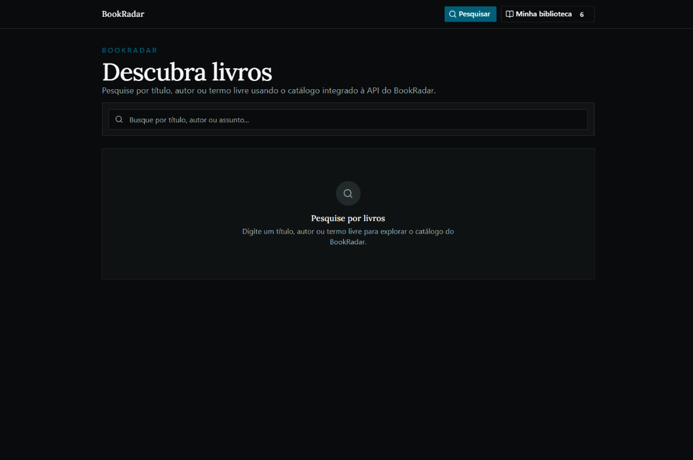
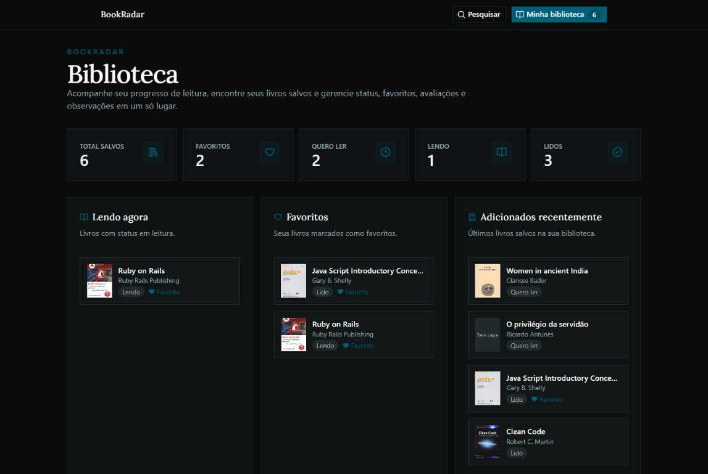
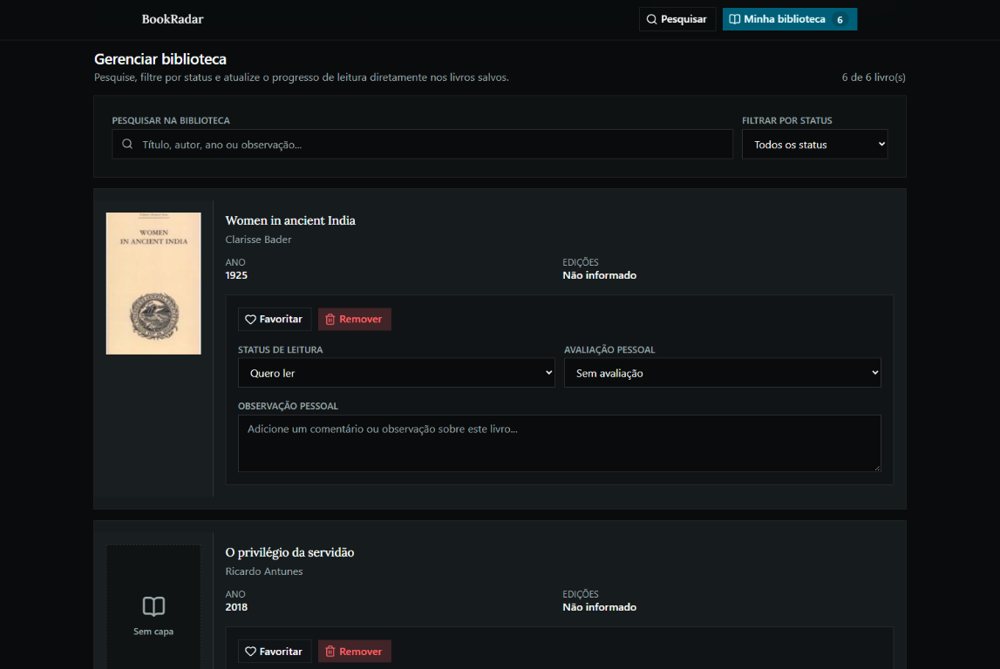

# BookRadar

BookRadar é uma aplicação educacional para pesquisar livros e organizar uma biblioteca pessoal de leitura. O projeto foi desenvolvido como exercício prático de aprendizado de Ruby on Rails, combinando uma API Rails com uma interface React para explorar conceitos de backend, integração com uma API externa e estado no cliente.

> Este repositório representa um projeto de estudo. Ele não é apresentado como um produto comercial nem como uma aplicação pronta para produção.

## Capturas de tela

| Pesquisa | Resultados da Open Library |
| --- | --- |
|  |  |

| Biblioteca pessoal | Gerenciamento dos livros |
| --- | --- |
|  |  |

## Funcionalidades implementadas

- Pesquisa por título, autor ou termo livre.
- Paginação dos resultados da Open Library.
- Estados de carregamento, erro, resultados vazios e busca inicial.
- Adição e remoção de livros da biblioteca.
- Prevenção de livros duplicados.
- Organização por status: **Quero ler**, **Lendo** e **Lido**.
- Marcação de favoritos.
- Avaliação pessoal de 1 a 5 estrelas.
- Observações pessoais por livro.
- Dashboard com totais por status, favoritos e livros recentes.
- Pesquisa interna por título, autor, ano ou observação.
- Persistência local e sanitização dos dados salvos no navegador.

## Tecnologias

### Backend

- Ruby 4.0.10
- Ruby on Rails 8.1, em modo API
- Puma
- SQLite
- `Net::HTTP`
- Rails Cache
- Minitest
- RuboCop, Brakeman e Bundler Audit

### Frontend

- React 19
- TypeScript
- Vite 8
- TanStack React Query
- Tailwind CSS 4
- shadcn/Base UI, Lucide React e fontes Lora
- Vitest e Testing Library
- ESLint

## Arquitetura

O repositório está dividido em duas aplicações independentes:

```text
bookradar/
├── backend/   # API Ruby on Rails
└── frontend/  # SPA React + TypeScript
```

O fluxo principal é:

1. O usuário digita um termo no frontend.
2. Após um debounce de 400 ms, o React Query chama `GET /api/v1/books/search`.
3. O controller Rails valida os parâmetros de busca.
4. `OpenLibrary::SearchService` consulta a API de pesquisa da Open Library.
5. A resposta externa é validada e normalizada.
6. O Rails devolve ao frontend um contrato JSON próprio, com paginação e dados dos livros.
7. Livros salvos pelo usuário são mantidos no `localStorage`, sob a chave `bookradar.library.v1`.

Em desenvolvimento, o proxy do Vite encaminha requisições iniciadas por `/api` para o Rails em `http://localhost:3000`. Isso evita CORS no fluxo local. O middleware de CORS existe apenas como configuração comentada no backend.

### Persistência e cache

Há dois mecanismos de armazenamento diferentes no projeto:

- **Biblioteca pessoal:** persistida no `localStorage` do navegador. Ela pertence ao dispositivo e navegador usados, sem autenticação ou sincronização entre dispositivos.
- **Cache das pesquisas da Open Library:** mantido pelo Rails por 15 minutos. Em desenvolvimento, o cache usa memória; em produção, a configuração seleciona Solid Cache.

SQLite, Active Record, Solid Queue e Solid Cable estão disponíveis na estrutura do Rails, mas o projeto não possui um modelo Active Record para salvar livros ou usuários no momento.

## Organização do backend

```text
backend/app/
├── controllers/api/v1/
│   ├── books_controller.rb
│   └── health_controller.rb
├── models/
└── services/open_library/
    └── search_service.rb
```

Rotas expostas:

```text
GET /api/v1/health
GET /api/v1/books/search?q=termo&page=1&per_page=10
```

`per_page` aceita no máximo 50 itens. Respostas de falha identificam erros de parâmetros, timeout, conexão, indisponibilidade e resposta inválida da integração.

## Organização do frontend

```text
frontend/src/
├── components/   # Cartões, paginação, estados e componentes de UI
├── contexts/     # Estado compartilhado da biblioteca
├── features/     # Telas de pesquisa e biblioteca
├── hooks/        # Busca, debounce e acesso à biblioteca
├── services/     # Cliente HTTP e persistência local
└── types/        # Contratos de livros, API e biblioteca
```

## Pré-requisitos

- Ruby **4.0.10**, conforme `backend/.ruby-version`
- Bundler
- Node.js **20.19 ou mais recente na linha 20**, ou **22.12 ou mais recente**
- npm
- Acesso à internet para instalar dependências e consultar a Open Library

## Instalação

Na raiz do repositório:

```bash
cd backend
bundle install
ruby bin/rails db:prepare

cd ../frontend
npm ci
```

## Variáveis de ambiente

O frontend fornece `frontend/.env.example`:

```dotenv
VITE_API_BASE_URL=
```

No desenvolvimento local, o valor pode permanecer vazio porque o Vite usa seu proxy para `/api`. Para apontar o frontend diretamente para outro backend, crie `frontend/.env` e informe a URL completa, por exemplo:

```dotenv
VITE_API_BASE_URL=http://localhost:3000
```

Nesse caso, o backend publicado em outro domínio precisará ter uma política de CORS compatível configurada. A aplicação Rails não requer variáveis de ambiente específicas da Open Library.

## Executando localmente

Inicie os serviços em terminais separados.

### Backend

```bash
cd backend
ruby bin/rails server
```

API disponível por padrão em `http://localhost:3000`.

Verificação rápida:

```text
GET http://localhost:3000/api/v1/health
```

### Frontend

```bash
cd frontend
npm run dev
```

O Vite exibirá a URL local do frontend no terminal.

## Testes

### Backend

```bash
cd backend
ruby bin/rails test
```

Também é possível executar a checagem integrada configurada pelo Rails:

```bash
ruby bin/ci
```

Ela cobre configuração, RuboCop, auditoria de gems, Brakeman, testes Rails e preparação de seeds.

### Frontend

```bash
cd frontend
npm test
npm run lint
npm run build
```

Os testes frontend cobrem o cliente HTTP, construção das consultas, persistência da biblioteca, estados da busca e interações de gerenciamento dos livros.

## Integração com a Open Library

O endpoint externo usado pelo backend é:

```text
https://openlibrary.org/search.json
```

A integração solicita somente os campos usados pela interface, aplica timeouts de conexão e leitura, limita o tamanho das páginas e converte a resposta da Open Library para o contrato JSON do BookRadar. As capas são montadas com as URLs de capa oficiais a partir de `cover_i`.

Não é necessária uma chave de API.

## Melhorias futuras

As possibilidades abaixo são ideias de evolução e **não estão implementadas**:

- criar autenticação e sincronização da biblioteca entre dispositivos;
- persistir livros e metadados pessoais em um backend próprio;
- adicionar histórico de progresso e metas de leitura;
- ampliar as opções de ordenação e filtros;
- configurar CORS explicitamente quando frontend e backend forem hospedados em origens diferentes;
- criar testes end-to-end do fluxo completo;
- publicar ambientes de demonstração para frontend e API;
- documentar observabilidade e estratégias operacionais de produção.

## Propósito educacional

O objetivo principal do BookRadar é colocar conceitos de Ruby on Rails em prática por meio de uma aplicação pequena, mas completa: rotas versionadas, controllers, service objects, integração HTTP, cache, tratamento de erros, testes e configuração de uma API. O React permanece responsável por uma experiência interativa rica, enquanto o Rails concentra o contrato da API e o acesso ao catálogo externo.
